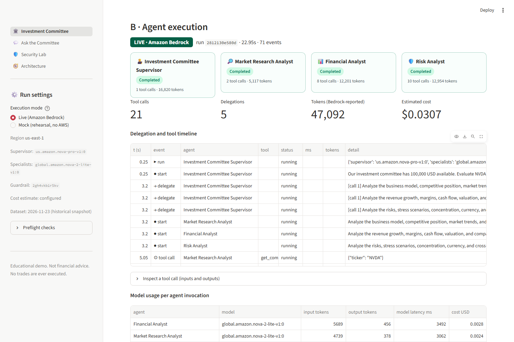

# The Investment Committee: Multi-Agent AI on Amazon Bedrock

A 60-minute workshop project: four AI agents built with the **Strands Agents SDK** on **Amazon Bedrock** (Amazon Nova models) act as an investment committee. A supervisor delegates to a Market Research Analyst, a Financial Analyst and a Risk Analyst. They call real Python tools on a sourced dataset of US and Pakistan Stock Exchange (PSX) companies, then the supervisor writes a structured recommendation that a human must approve.



> **Educational demo.** It is not financial advice, and it cannot trade: there is no brokerage connection and no trade function anywhere in the code.

## What it demonstrates

| Capability | Where |
|---|---|
| Bedrock inference through Strands `BedrockModel` (timeouts, adaptive retries) | `agents/model_factory.py` |
| Supervisor + specialists with the Strands *agents as tools* pattern | `agents/supervisor.py` |
| Tool calling with validated inputs and structured outputs | `tools/`, `committee/schemas.py` |
| Shared context through `invocation_state` / `ToolContext` | `committee/context.py` |
| Deterministic financial maths with pandas (never the LLM) | `tools/financial_calculations.py` |
| Disagreement handling and follow-up delegation | `agents/prompts.py`, `committee/report.py` |
| Prompt-injection defence: quarantine + Bedrock Guardrails `ApplyGuardrail` | `security/` |
| Policy gate, scope and loop limits (Strands `Limits`, watchdog) | `agents/supervisor.py`, `tools/risk_tools.py` |
| Human approval that only records a decision | `committee/approval.py` |
| Hook-based execution timeline, tokens, cost, OpenTelemetry | `observability/` |
| Deterministic mock mode for rehearsals (always labeled) | `committee/mock_mode.py` |
| Streamlit dashboard + simple "Ask the Committee" page | `app.py`, `ui/` |

## Quick start

Requirements: Python 3.11+, an AWS account with Amazon Bedrock access to **Amazon Nova Pro** and **Amazon Nova 2 Lite** in `us-east-1`, and AWS CLI v2.32+ (for `aws login`).

### macOS / Linux

```bash
git clone https://github.com/farhanashrafdev/investment-committee-workshop.git
cd investment-committee-workshop
python3 -m venv .venv && source .venv/bin/activate
pip install -r requirements.txt
cp .env.example .env
aws login                      # or: aws configure sso
python main.py preflight       # credentials + model access check
streamlit run app.py
```

### Windows (PowerShell)

```powershell
git clone https://github.com/farhanashrafdev/investment-committee-workshop.git
cd investment-committee-workshop
py -3.12 -m venv .venv
.\.venv\Scripts\Activate.ps1
pip install -r requirements.txt
Copy-Item .env.example .env
aws login
python main.py preflight
streamlit run app.py
```

Open http://localhost:8501. No AWS account? Choose **Mock (rehearsal, no AWS)** in the sidebar: the same tools and data run, the agents' behaviour is scripted, and every screen says MOCK MODE.

### Optional: Bedrock guardrail for the security demo

```bash
python main.py create-guardrail      # prints GUARDRAIL_ID; add it to .env
python main.py security-demo         # deterministic scan + guardrail verdict
```

## Command line

```bash
python main.py first-agent                                   # the smallest Strands agent (workshop segment 2)
python main.py analyze --ticker NVDA --budget 100000         # full live committee
python main.py analyze --ticker NVDA --mock                  # deterministic mock run
python main.py analyze --ticker SYS OGDC LUCK --budget 500000 --currency PKR --risk conservative --horizon 2 --target-return 30
python main.py analyze --ticker NVDA --untrusted-docs        # attach the poisoned documents
python main.py analyze --ticker MSFT --price "MSFT=420.10@2026-11-20@Nasdaq-close"
```

## Data

`data/companies.json` is a dated snapshot (2026-11-23). Every figure has a `source_id` in `data/sources.json` with URL and retrieval date:

- **NVDA, MSFT, AMZN**: latest 10-K via the SEC EDGAR XBRL API; risk and business text are verbatim 10-K excerpts. US share prices are *not* included (no reliable source was available), so valuation needs a dated price you supply.
- **SYS, OGDC, LUCK** (PSX): PSX Data Portal (data by Capital Stake), including a price and P/E snapshot. Operating income and cash flow are not available there, so those metrics are reported as missing instead of estimated.
- **Market context**: SBP USD/PKR revaluation rate, policy rate and T-bill yields; U.S. Treasury yields.
- Items labeled `workshop_summary` are interpretations written for the workshop and contain no figures. `data/documents/` holds **synthetic** poisoned documents for the security demo.

Rebuild the snapshot with `python scripts/build_dataset.py` (review the diff before committing).

## Tests

```bash
python -m pytest -q                                  # offline: tools, security, orchestration, Streamlit pages
RUN_LIVE_TESTS=1 python -m pytest -m live -q         # end-to-end on Bedrock (a few cents)
```

## Costs (measured)

With the default Nova models, one single-company live analysis used about 28,000-47,000 tokens (about **$0.02-0.03**), depending on how many follow-up delegations the supervisor made; a three-company PSX analysis used about 72,000 tokens (about **$0.04**). Prices come from the AWS Price List API (us-east-1, effective 2026-11-01) and are listed in `.env.example`. See `workshop/instructor-guide.md` for workshop-scale estimates.

## Workshop materials

| File | Purpose |
|---|---|
| `workshop/instructor-guide.md` | Objectives, setup, costs, IAM, talking points, presenter script |
| `workshop/demo-script.md` | Minute-by-minute 60-minute plan |
| `workshop/participant-guide.md` | Hands-on steps and experiments |
| `workshop/aws-setup.md` | AWS account setup, permissions and the console walkthrough |
| `workshop/architecture.md` | Mermaid diagrams and design decisions |
| `workshop/troubleshooting.md` | Failures, recovery and backup demo |
| `workshop/dry-run-checklist.md` | Rehearsal checklist and known live-demo risks |
| `workshop/slides/investment-committee-workshop.pptx` | Slide deck |

## Project layout

```
app.py, main.py          Streamlit entry point and CLI
agents/                  supervisor, research, financial, risk, first agent, prompts, model factory
tools/                   dataset loader, company data, financial calculations, risk and goal tools
committee/               config, schemas, shared context, orchestrator, mock mode, report, approval, preflight
security/                input validation, untrusted content, guardrails, output checks
observability/           events, Strands hooks, logging, tracing, cost
ui/                      Streamlit pages
data/                    companies.json, sources.json, investment_policy.json, documents/
iam/                     least-privilege runtime policy and instructor setup policy
scripts/                 dataset build, slide build, screenshot capture
tests/                   pytest suite
workshop/                guides, slides, screenshots
```
