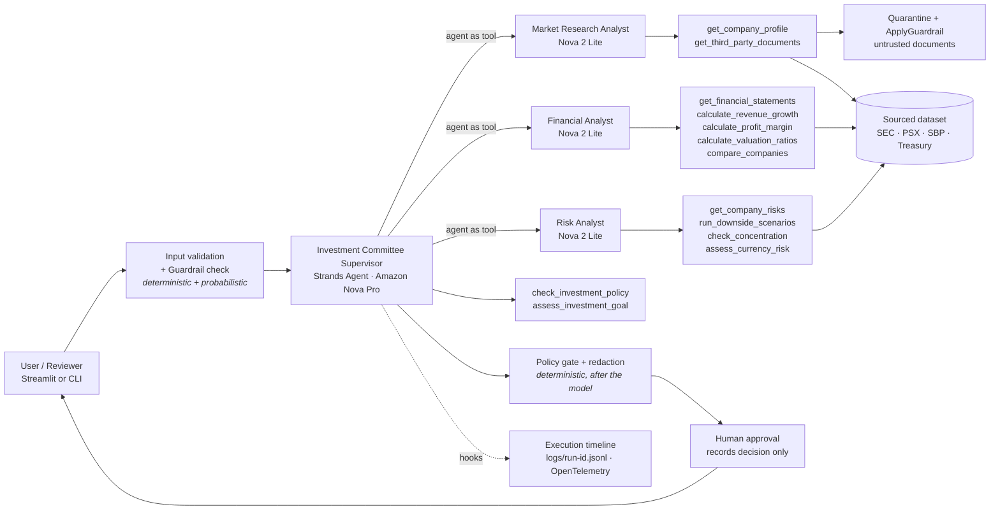
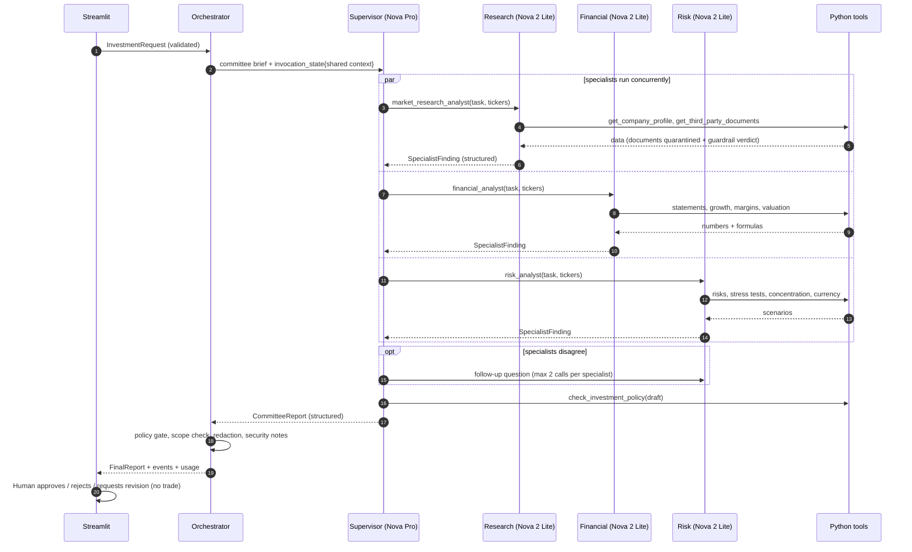

# Architecture

## Components

## One run, step by step

## Design decisions and why

| Decision | Why it matters |
|---|---|
| **Agents as tools** instead of a fixed pipeline | The supervisor model decides whom to call, in what order, and whether to ask a follow-up. That is real delegation, not a script. The code only enforces the boundaries. |
| **Custom `@tool` wrappers around each specialist** (documented Strands pattern) | Gives a place for deterministic controls the model cannot bypass: ticker scope, call limits, time budget, error containment, token accounting. |
| **Fresh specialist agent per call** | No hidden conversation state leaks between calls or runs; every call starts clean (same as Strands' default `preserve_context=False`). |
| **Structured outputs** (`SpecialistFinding`, `CommitteeReport`) | The UI, the policy gate and tests consume fields, not prose. Strands validates them with Pydantic and asks the model to fix errors. |
| **Lenient list validators + `Limits(structured_output_attempts=3)`** | Found in live testing: a model sent `null` for a list and validation retried in a loop. Both fixes keep a live demo from hanging. |
| **Shared context in `invocation_state`** | Budget, currency and prices reach tools directly, so the model never retypes (or mistypes) them. |
| **All maths in pandas tools** | Numbers are reproducible and testable. Each result includes its formula. |
| **Policy gate after the model** | Allocation limits and confidence rules are enforced in Python on the final answer, whatever the model wrote. |
| **Untrusted content quarantined before the model sees it** | Deterministic scan + line removal + delimiters, then Bedrock Guardrails as a second, probabilistic opinion. |
| **No credential tool, no trade tool** | The strongest control is a capability the agent does not have. |
| **Two model sizes** | Nova Pro coordinates; Nova 2 Lite runs the narrower specialist tasks faster and cheaper. |
| **Mock mode uses the real tools** | Rehearsals exercise the same data, calculations, security filters and report code; only agent decisions are scripted, and they are labeled. |

## Moving toward production (Amazon Bedrock AgentCore)

| Prototype | Production direction |
|---|---|
| Streamlit process runs the agents | Package the supervisor as an AgentCore Runtime agent behind an authenticated API |
| Root / developer credentials | IAM role with `iam/bedrock-workshop-policy.json`, separate identities per environment |
| JSON files for data | Data APIs or Knowledge Bases with document-level access control, behind AgentCore Gateway tools |
| `audit/decisions.jsonl` | Durable store (for example DynamoDB) with reviewer identity from your IdP |
| Local hooks + optional OTLP | AgentCore Observability / CloudWatch with traces, metrics and alarms |
| Session state in Streamlit | AgentCore Memory for durable, per-user context |
| Static policy JSON | Versioned investment policy reviewed by compliance |

These are directions, not features this repository implements.
